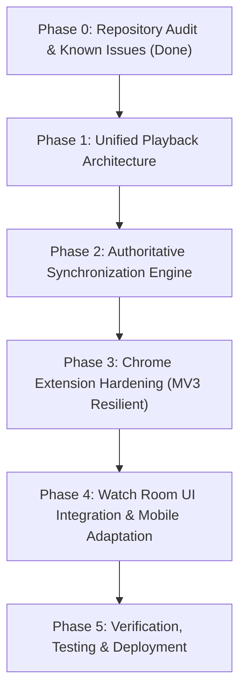

# VYBE — Architecture & Reliability Implementation Plan

**Objective:** Transform VYBE into a production-grade hybrid watch-party platform with unified playback architecture, resilient synchronization, hardened Chrome Extension integration, and full mobile support—while strictly preserving the existing aesthetic, layout, animations, and component structure.

---

## Phase Overview



---

## Phase 1 — Unified Playback Architecture

### Goal
Decouple the room UI from provider-specific playback implementations by establishing a single, extensible player interface and capability model.

### Directory Structure to Create
```
src/
  lib/
    playback/
      types.ts                  # Common interfaces, capabilities, playback state
      playback-manager.ts       # Unified coordinator managing active provider
      sync-engine.ts            # High-level synchronization orchestrator
      providers/
        base-provider.ts        # Abstract base class with event emitters
        youtube-provider.ts     # YouTube IFrame API adapter
        netflix-companion.ts    # Netflix companion & extension bridge adapter
        local-media-provider.ts # HTML5 Video & custom personal stream adapter
      sync/
        clock.ts                # Server-authoritative drift & monotonic time
        drift-correction.ts     # Tiered drift algorithm (ignore, rate adjust, seek)
        event-validation.ts     # Sequence number, permission, and origin checks
```

### Key Deliverables
1. **Normalized Playback State (`src/lib/playback/types.ts`):**
   - `provider`: `'youtube' | 'netflix' | 'local_media'`
   - `mediaId`, `title`, `posterUrl`
   - `currentTime`, `duration`, `playbackRate`
   - `isPlaying`, `isBuffering`, `isSeeking`
   - `sequenceNumber`, `updatedAt`, `hostId`, `roomId`
2. **Provider Capabilities (`PlayerCapabilities`):**
   - `canPlay`, `canPause`, `canSeek`, `canChangeRate`, `canSetVolume`
   - `supportsEmbeddedPlayback`, `supportsExternalPlayback`, `supportsSubtitles`
   - `supportsMobile`
3. **Playback Provider Contract (`IPlaybackProvider`):**
   - `initialize(container: HTMLElement, config: PlaybackConfig): Promise<void>`
   - `play(): Promise<void>`, `pause(): Promise<void>`, `seek(time: number): Promise<void>`
   - `setPlaybackRate(rate: number): void`, `setVolume(vol: number): void`
   - `getState(): NormalizedPlaybackState`, `getCapabilities(): PlayerCapabilities`
   - `destroy(): void`
4. **Concrete Provider Implementations:**
   - **`YouTubeProvider`**: Wraps YouTube IFrame API; handles script singleton loading, error recovery, and event isolation.
   - **`LocalMediaProvider`**: Wraps HTML5 `<video>` element for local uploaded `.mp4`/`.mkv`/`.webm` files or direct `.m3u8`/`.mp4` stream links with full subtitle support.
   - **`NetflixCompanionProvider`**: Coordinates extension bridge, tab casting (`getDisplayMedia`), and companion link states.

---

## Phase 2 — Reliable Synchronization Engine

### Goal
Implement a single authoritative synchronization engine that prevents command feedback loops, compensates for network latency, and handles participants joining mid-stream.

### Key Deliverables
1. **Clock & Monotonic Sequence System (`src/lib/playback/sync/clock.ts`):**
   - Track local clock skew relative to server timestamps (`Date.now() - serverUpdatedAt`).
   - Monotonically incrementing sequence numbers (`seq: number`) for every playback command.
   - Reject any incoming command with `seq <= lastAppliedSeq`.
2. **Command Origin & Loop Prevention (`src/lib/playback/sync/event-validation.ts`):**
   - Explicitly tag every state transition with its origin:
     - `origin: 'user'` (local button click or seek bar drag by an authorized controller)
     - `origin: 'remote'` (network event from authoritative host)
     - `origin: 'system'` (track ended, buffering stall)
   - When executing a `remote` command, silence outbound event emission until the media confirms the new state.
3. **Tiered Drift Correction (`src/lib/playback/sync/drift-correction.ts`):**
   - Calculate drift: `drift = |playerCurrentTime - (authoritativeTime + elapsedSinceUpdate)|`.
   - **Zone 1: Natural Drift (< 0.35s)**: Zero intervention. Ensures natural audio pitch and no skipping.
   - **Zone 2: Subtle Drift (0.35s – 1.50s)**: Smooth rate adjustment. If player is behind, set `playbackRate = 1.05`; if ahead, set `playbackRate = 0.95`. When drift drops below 0.15s, restore `playbackRate = 1.0`.
   - **Zone 3: Hard Drift (> 1.50s)**: Issue authoritative `seekTo()`.
4. **Host Authority & Reconnection Handling:**
   - Strict enforcement: only `host` (or `cohost` when permission is set to `cohosts`) can emit `PLAYBACK_SYNC`.
   - When a new participant joins during active playback, calculate project elapsed time immediately and synchronize without waiting for the host's next action.

---

## Phase 3 — Chrome Extension Hardening (Manifest V3)

### Goal
Make the Chrome Extension resilient to service worker suspension, eliminate indiscriminate tab queries, and prevent event feedback loops.

### Key Deliverables
1. **Storage-Backed Session State (`chrome-extension/background.js`):**
   - Replace in-memory `let sessionState` with `chrome.storage.local`.
   - On every message or wakeup, retrieve active room pairing and URL configuration from storage.
2. **Targeted Tab Messaging:**
   - Replace `chrome.tabs.query({}, ...)` with URL-filtered queries:
     ```js
     chrome.tabs.query({ url: ['*://*.netflix.com/*', 'https://vybe.nooryoosuf.com/*', 'http://localhost:*/*'] })
     ```
3. **Netflix Video Observer (`chrome-extension/content-netflix.js`):**
   - Use `MutationObserver` on `#appMountPoint` to automatically detect when Netflix re-renders the `<video>` element (e.g. during episode auto-play or intro skips).
   - Implement command-origin locking to prevent native `play`/`pause`/`seeked` events from re-triggering network broadcasts.

---

## Phase 4 — Watch Room UI Integration & Mobile Adaptation

### Goal
Refactor `WatchRoomClient.tsx` to consume the new `PlaybackManager` while strictly preserving the visual layout, Aceternity effects, floating reactions, chat, and drawer interactions.

### Key Deliverables
1. **Unified Theater Stage (`src/components/room/TheaterStage.tsx`):**
   - Mounts the active provider returned by `PlaybackManager`.
   - Dynamically renders player controls derived from `provider.getCapabilities()` (e.g. disable seek bar if external provider restricts seeks).
   - Preserves floating reaction overlays, subtitles, and fullscreen behaviors.
2. **Seamless Provider Switching:**
   - Allow switching between YouTube, Arcane Netflix companion, and Local Personal Media without reloading the room or resetting chat/participants.
3. **Mobile-Responsive Enhancements:**
   - Clean "Tap to Play" overlay when mobile browsers block unmuted autoplay.
   - Graceful fallback for screen casting on mobile with explicit guidance.

---

## Phase 5 — Verification & Deployment

### Key Deliverables
1. Comprehensive TypeScript type-checking (`npx.cmd tsc --noEmit`).
2. Production build verification (`npm.cmd run build` via Cloudflare export pipeline).
3. Cloudflare Worker deployment to `vybe.nooryoosuf.com`.
4. Commit and push clean incremental changes to `https://github.com/nooryoosuf/vybe`.
